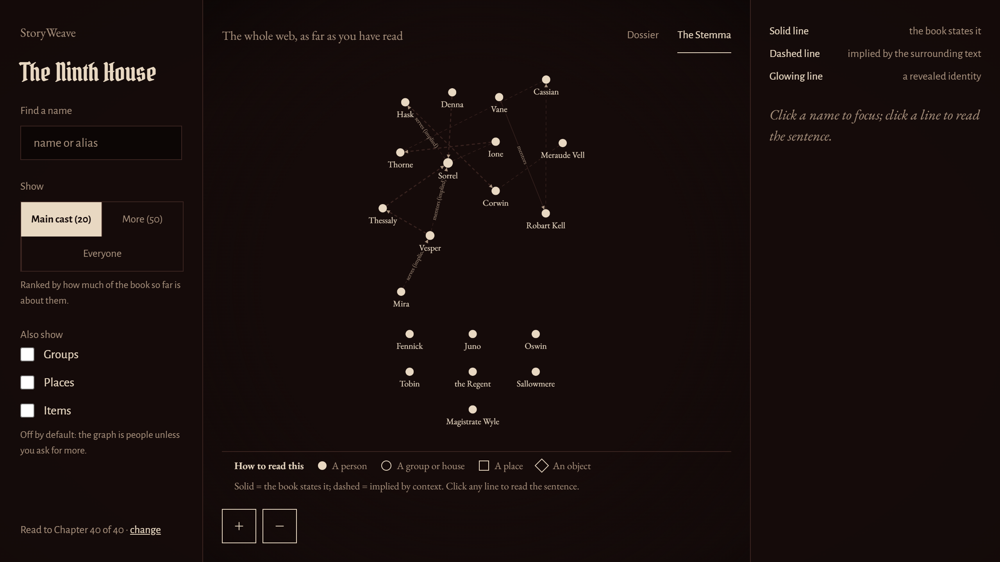

# StoryWeave

A local tool that builds a character graph of a novel which only shows what a reader has
been told up to the chapter they have reached.

Status: academic project, version tag `retrofit-v1.0` (final state `retrofit-v1.0-final`).
Not maintained as a product.

## What it does

You tell StoryWeave "I have read up to chapter *n*". It shows the people, groups, places and
objects of the story, and the relationships between them, that the text has revealed by
chapter *n*, and nothing later. Every node and edge stores the chapter at which a reader
learns it (`revealed_chapter`). The rule `revealed_chapter <= n` is applied in one place,
the query layer (`storyweave/query/fence.py`, executed by `storyweave/db/repository.py`),
so the browser never receives anything from later chapters. Every drawn relationship
carries the sentence from the book that supports it.



*Chapter 40 of the evaluation novel, default view: the 20 most central characters.
Solid lines are stated in the text, dashed lines are implied. Captured in phase R7
(`evidence/retrofit/shots/R7/`).*

## Results

All values below are [MEASURED] on one 40-chapter novel (*The Ninth House*, written for this
project). The full write-up is [`evidence/retrofit/EVAL_RETROFIT.md`](evidence/retrofit/EVAL_RETROFIT.md).

| metric | v1 | retrofit | label | source |
| --- | ---: | ---: | --- | --- |
| spoiler-fence violations / elements checked | 0 / 105,243 | 0 / 28,869 (12,660 queries) | [MEASURED] | `logs/R8_eval_fence.log` |
| relation micro-F1, v1 answer key | 0.0459 | 0.0000 | [MEASURED] | `logs/R8_score_final_v1key.log` |
| wrong relationship lines (false positives), v1 key | 162 | 7 | [MEASURED] | `logs/R8_score_final_v1key.log` |
| entity F1, v1 8-type key | 0.5319 | 0.5682 | [MEASURED] | `logs/R8_score_final_v1key.log` |
| entity F1, 4-type key | n/a | 0.6250 | [MEASURED] | `logs/R8_score_final_proj.log` |
| alias F1 / wrongly merged identities | n/a | 0.7500 / 0 | [MEASURED] | `logs/R8_score_final_proj.log` |
| salience AUC (only chapter 9 has negatives) | n/a | 0.6667 | [MEASURED] | `evidence/retrofit/logs/R6_salience_score.log` |
| default view at chapter 40 (dots / lines) | 152 / 976 | 20 / 18 | [MEASURED] | `logs/R8_compare.log` |
| median `/graph` request at chapter 40 | 28.2 ms | 11.3 ms | [MEASURED] | `logs/R8_compare.log` |
| pre-registered predictions | | 19: 6 inside band, 12 outside, 1 badly specified | [MEASURED] | `evidence/retrofit/PROJECTION_CHECK.md` |

How to read these:

- **Relationship extraction does not work yet.** F1 fell from 0.0459 to 0.0000. v1's five
  correct relationships all came from a co-occurrence rule that also produced 160 of its
  162 wrong ones. That rule is now off. The replacement only draws a relationship when a
  sentence names both people, and English often names one of them as "she" or "he", so the
  rule rejects most true relationships. The result is a graph with very few wrong lines and
  very few right ones. Resolving pronouns (coreference) is the main open problem
  (`EVAL_RETROFIT.md` §4).
- **Salience is modest.** The AUC of 0.6667 comes from one chapter; at the other two annotated
  chapters every matched entity is significant, so the metric cannot discriminate there.
- **The fence count.** 28,869 is recounted from the per-element-kind totals in
  `logs/R8_eval_fence.log`, which sum to the logged total. An earlier figure of 28,046
  (`evidence/retrofit/logs/R6_eval_fence.log`) is from phase R6, before R7 widened the
  default cast; both runs found 0 violations, and in both the injected test leaks were detected.

## What this does not show

- One novel for the main evaluation, and that novel was generated for the project, so its
  prose may be more regular than a published book.
- A small answer key: 3 annotated chapters (9, 17, 37). The annotation was produced by a model
  and hand-checked for spans; it is not independent human ground truth, and no
  inter-annotator agreement was measured.
- Relationship extraction is weak (see above). Over half the reference relations fall outside
  the twelve supported relation types by design.
- The local LLM pass (qwen2.5:7b through Ollama) is optional; without it the system still
  builds a graph, with fewer relationships.
- The interface is designed for desktop first. Phone layouts were captured in R7, but
  usability was not tested with readers.
- Request times are in-process test-client timings, not production latency. Extraction time
  was not re-measured in the final phase.

## Architecture

```
chapters (.txt) -> ingest: clean, split, chunk          storyweave/ingest
                -> entities: GLiNER, 4 drawn types      storyweave/extract, storyweave/nlp
                -> relations: GLiNER-RelEx + optional LLM proposals,
                   checked by a validator (12 closed types, verbatim quote)
                -> SQLite (source of truth; all SQL in db/repository.py)
                -> salience rank per chapter, from chapters <= n only
                -> query layer: fence clause first, then display clauses (cast size, types, grade)
                -> FastAPI (storyweave/api) -> React + Cytoscape (frontend/), renders what it receives
```

Detail: [`docs/retrofit/design/ARCHITECTURE.md`](docs/retrofit/design/ARCHITECTURE.md).

## Quick start (Windows, everything local)

Requires Git, Python 3.12+ and Node.js. `dev.ps1` creates no global state; it sets caches
for this shell to folders inside the repo.

```powershell
git clone https://github.com/Shashank-ssls/StoryWeave.git
cd StoryWeave
py -3.12 -m venv .venv
.\dev.ps1                                   # activates .venv, pins caches inside the repo
pip install -e ".[dev]"
python tools/check_local_env.py             # must print PASS
storyweave seed-demo --no-ninth-house --db storyweave-demo.sqlite
```

The last command prints `seeded 'the-hollow-crown' (work id=1) into storyweave-demo.sqlite`.
Then run the backend and the frontend in two shells:

```powershell
# shell 1
.\dev.ps1
$env:STORYWEAVE_DB_PATH = "storyweave-demo.sqlite"
python -m uvicorn storyweave.api.app:app --port 8000

# shell 2
cd frontend
npm install
npm run dev                                 # http://localhost:5173, proxies /api to :8000
```

`.\run.ps1` is an alternative that builds the frontend and serves it from the API on port 8000.

**Optional ML path** (to process a novel yourself): create `.venv-ml` with Python 3.12, then
`.\dev.ps1 -Ml`, install `torch` from the CPU index and `pip install -r requirements-ml.txt`.
GLiNER weights download to the Hugging Face cache on first use. The LLM pass needs Ollama
running locally with `qwen2.5:7b`; it is off by default. The evaluated database
(`data/retrofit/ninth_house_r6.db`) is not in the repo; it is rebuilt by the phase scripts
`tools/build_r3_db.py` to `tools/build_r6_db.py`, and each phase's
`evidence/retrofit/R*_RESULT.md` gives the exact command.

## Tests

```powershell
.\dev.ps1
python -m pytest            # 318 passed, 6 skipped [MEASURED, this commit]
ruff check .                # All checks passed!
mypy                        # Success: no issues found in 112 source files
cd frontend
npm run build
npx playwright test --workers=1   # browser suite; needs the API on :8000 (see below)
```

The browser suite drives the installed Chrome and needs the API from the quick start running
on port 8000. The database must contain both sample works, because the arcs test asks for
chapter 5 and the Hollow Crown has only 4 chapters. Building the Ninth House runs the GLiNER
pipeline, so seed from the ML environment: `.\dev.ps1 -Ml`, then
`storyweave seed-demo --db storyweave-demo.sqlite`. Last full run [MEASURED, 2026-11-12, `evidence/retrofit/FINAL_COMPLETION.md`]:
100 passed, 1 skipped, 1 failed. The failure was an animation timing assertion
(`reveal-choreography.spec.ts`), which passed on each of 3 reruns. It is timing-sensitive
under load, not a fixed defect.

The evaluation and screenshot scripts in `tools/` need `pip install -e ".[figures,tools]"`
(matplotlib, numpy, pillow, playwright).

CI (`.github/workflows/ci.yml`) runs ruff, mypy, pytest and the frontend build.

## Repository layout

```
storyweave/   Python package: ingest, extract, db, graph, query (fence), api, cli
frontend/     React + Cytoscape client and its Playwright tests
tests/        pytest suite, including the fence tests
tools/        evaluation, figure and database-build scripts, local-environment check
eval/         older model probes (NER, relex, identity, LLM gate)
data/         two CC0 sample novels and their labels; data/raw/ is for your own text (ignored)
evidence/     frozen v1 baseline, annotation, every phase result, logs, figures, screenshots
logs/         R7 and R8 run logs cited by the evaluation
docs/         design specs, retrofit phase documents, the C: drive ledger
docker/       empty placeholder
```

## v1 compared with the retrofit

- The co-occurrence relationship rule is off (`relations.cooccurrence_enabled = false`); it
  produced 160 of v1's 162 wrong relationship lines.
- Four node types are drawn (Character, Organization, Place, Item) instead of eight; the
  default view shows characters only.
- Twelve closed relation types; anything else is rejected in code, and every edge needs a
  verbatim quote. Implied edges are drawn dashed and labelled "(implied)".
- Display filters (cast size, node types, grade) are separate SQL clauses after the fence.
  v1's cast filter ran in the browser and had no effect.
- Cast size is chosen by a salience rank computed only from chapters up to *n*, so the
  ranking itself does not leak later chapters.
- The frontend was reworked so that a non-technical reader can follow the default view.

## How this was built

The work was done in pre-registered phases R0 to R8. The phase prompts, progress log and
design notes are in [`docs/retrofit/`](docs/retrofit/); every measurement, log and screenshot
is in [`evidence/`](evidence/). Every C: drive change made during the project is recorded in
[`docs/retrofit/C_DRIVE_LEDGER.md`](docs/retrofit/C_DRIVE_LEDGER.md).

## Licence and acknowledgements

Code: [MIT](LICENSE), Shashank Singhal. Both sample novels in `data/samples/` are original
works released under CC0 (see the `LICENSE.md` in each folder).

Models and libraries, with the licences stated in their own metadata:
GLiNER (Apache-2.0) with the `urchade/gliner_small-v2.1` model (Apache-2.0);
`knowledgator/gliner-relex-base-v1.0` (Apache-2.0); FastAPI (MIT); Pydantic (MIT);
Typer (MIT); NetworkX (BSD-3-Clause); React (MIT); Cytoscape.js (MIT).
Also used: `sentence-transformers/all-MiniLM-L6-v2` for search embeddings, and qwen2.5:7b
through Ollama for the optional LLM pass; see their model cards for terms.
